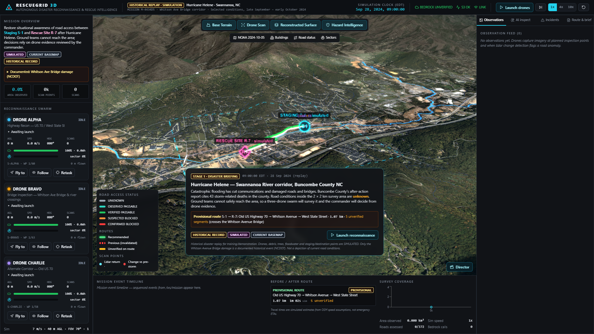
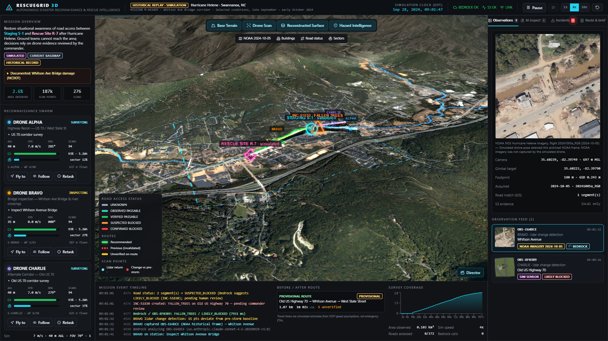
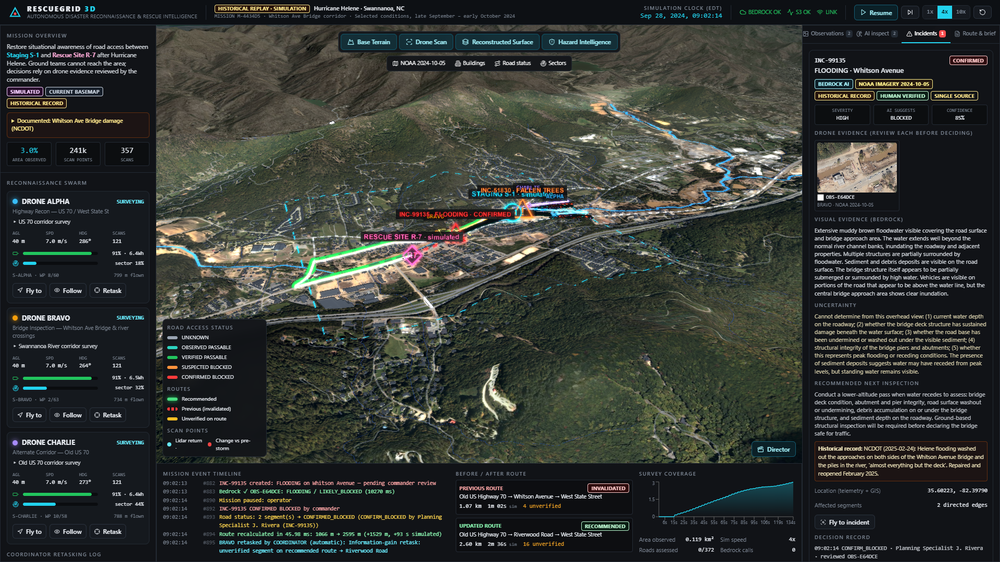

# RESCUEGRID 3D

**Autonomous Disaster Reconnaissance and Rescue Intelligence**. Built for SpartHill Hacks 2026, AWS Track.

RESCUEGRID 3D is a command center for a FEMA US&R planning specialist. It replays the conditions in
Swannanoa, NC after **Hurricane Helene (Sept 2024)**. Three simulated drones scan the real USGS terrain
with synthetic lidar, and the scans progressively build a 3D surface. Lidar change detection triggers
camera observations: real NOAA post-storm imagery where it exists, otherwise labeled synthetic
renders. **Amazon Bedrock** (Claude Sonnet 4.5, Converse API, image bytes) turns each observation
into structured hazard intelligence. The commander reviews the drone evidence and decides. The real
OpenStreetMap road graph is rerouted, a drone is retasked to the most valuable unverified crossing,
and Bedrock writes an evidence-grounded briefing for the approved *simulated* mission.

> Historical replay for demonstration. The drones, debris, fallen trees, floodwater and the
> staging/rescue points are simulated. The only documented historical event in the scenario is the
> Whitson Avenue Bridge damage (NCDOT). Not affiliated with or endorsed by FEMA or the National Guard.
> Real dispatch requires authorized personnel.





**Live deployment:** http://32.195.112.28 (EC2 t3.large behind an Elastic IP; Bedrock and S3 accessed through the instance role)

## Run locally (Windows)

Requirements: Python 3.11+ and Node 20+. AWS credentials are needed only for live Bedrock and S3.

```cmd
python -m venv .venv
.venv\Scripts\python -m pip install -r backend\requirements.txt
scripts\build_frontend.cmd
rem AWS creds: set AWS_ACCESS_KEY_ID / AWS_SECRET_ACCESS_KEY / AWS_SESSION_TOKEN / AWS_REGION
rem (or put those "set" lines in .secrets\aws.cmd, which is git-ignored)
run_backend.cmd
rem open http://127.0.0.1:8000
```

Dev mode with hot reload: `run_backend.cmd`, then `cd frontend && npm run dev` (http://localhost:5173 proxies to the API).

All geodata is already in `data/`. To regenerate it from the public sources:

```cmd
.venv\Scripts\python scripts\bootstrap_geodata.py      &rem OSM graph, bridge, river, buildings
.venv\Scripts\python scripts\prepare_terrain.py        &rem USGS 3DEP DEM (5 m + 30 m)
.venv\Scripts\python scripts\validate_route_scenario.py&rem proves the reroute exists
.venv\Scripts\python scripts\build_scenario.py         &rem scenario ground truth on real edges
.venv\Scripts\python scripts\fetch_noaa_imagery.py     &rem NOAA Helene coverage probe + crops
.venv\Scripts\python scripts\build_manifest.py         &rem data/manifest.json, docs/data_sources.md
.venv\Scripts\python scripts\make_drone_glb.py         &rem procedural drone model
```

## Environment variables

See `.env.example`. Main ones: `AWS_REGION`, `RESCUEGRID_BUCKET`, `RESCUEGRID_BEDROCK_MODEL`,
`RESCUEGRID_BEDROCK=0|1`, `RESCUEGRID_S3=0|1`, `RESCUEGRID_ALLOW_OFFLINE_FIXTURE` (rehearsal only,
always labeled), `RESCUEGRID_SEED`, `RESCUEGRID_UNKNOWN_PENALTY`. No Cesium ion token or other API keys
are needed.

## AWS setup

1. `scripts\verify_bedrock.py` checks STS, discovers vision models and inference profiles, makes a
   real image Converse call, and writes the model to `data/aws_config.json`.
2. S3 bucket `rescuegrid3d-<account>-us-east-1` with public access blocked and SSE-S3 encryption.
3. `scripts\deploy\deploy.py` creates the least-privilege IAM role, security group, log group and EC2
   instance. Details are in [docs/deployment.md](docs/deployment.md).

## Verify

| What | Command |
|---|---|
| Unit/integration tests (no AWS) | `scripts\run_tests.cmd` → `data\runtime\pytest.txt` |
| Full storyline headless, **live Bedrock** | `.venv\Scripts\python scripts\e2e_demo.py` → `docs/evaluation_run.json` |
| API smoke (local or EC2) | `.venv\Scripts\python scripts\smoke_api.py [url]` |
| Browser storyline + screenshots | `.venv\Scripts\python scripts\capture_story.py [url] docs\screens --full` |

## Docs

- [Architecture and the Bedrock request path](docs/architecture.md)
- [Data sources manifest](docs/data_sources.md)
- [Demo script (5 min)](docs/demo_script.md)
- [Evaluation and measured results](docs/evaluation.md)
- [Deployment](docs/deployment.md)
- [Reuse notes (signal-zero)](docs/reuse_notes.md)
- [Kiro workflow](docs/kiro_workflow.md)
- [Implementation checklist](IMPLEMENTATION_CHECKLIST.md)

## Known limitations

- The terrain is USGS 3DEP lidar from **before** the storm. Storm geometry (washout depth, debris,
  trees, flood level) is modeled, not measured.
- The OSM road graph is the *current* map. OSMnx doesn't model turn restrictions. Speeds are imputed,
  so travel times are simulated estimates, not ETAs.
- The NOAA imagery was flown 2024-10-05, about 8 days after the storm and after some cleanup. It's
  real evidence but wasn't captured by our drones. NOAA gives no accuracy guarantee.
- Bedrock can misread imagery. For example, it labeled the Whitson bridge as FLOODING rather than
  BRIDGE_DAMAGE. That's why every status change requires a named human decision.
- Heights use the NAVD88 values directly as scene heights (no geoid correction). This is consistent
  internally, but absolute heights are offset by about 30 m from the ellipsoid.
- SQLite and a single EC2 instance. No authentication beyond the operator-name field (demo scope).
